<picture>
  <source media="(prefers-color-scheme: dark)" srcset="assets/hero-dark.svg">
  <source media="(prefers-color-scheme: light)" srcset="assets/hero-light.svg">
  
</picture>

### I build production platforms, and the guardrails that let AI touch them safely.

**Roles I cover:** technical lead · architecture · full-stack (backend, frontend, data) · DevOps and infrastructure · AI guardrails · technical product management

By title I'm a Technical Product Manager at RVM CAD; in practice I own, lead and architect its four platforms, and the engineers on them work under me. On my own products I run the whole chain myself, from the domain and mail records to the server, CI/CD, backend and frontend. Before software I signed off Airbus A320 maintenance at Air India, and I still don't ship what I haven't verified.

  <a href="https://thisiskp.in"><b>thisiskp.in</b></a> (case studies with sources)&nbsp;&nbsp;·&nbsp;&nbsp;<a href="https://www.linkedin.com/in/prakash-kantumutchu">LinkedIn</a>&nbsp;&nbsp;·&nbsp;&nbsp;<a href="mailto:k.prakashofficial@gmail.com">Email</a>&nbsp;&nbsp;·&nbsp;&nbsp;<a href="https://strikehike.com">strikehike.com</a>

<picture>
  <source media="(prefers-color-scheme: dark)" srcset="assets/numbers-dark.svg">
  <source media="(prefers-color-scheme: light)" srcset="assets/numbers-light.svg">
  
</picture>

Method and commands at the end of the page.

- **Four platforms at RVM CAD, owned, led and architected by me:** BadaBhai (live alpha), the RVM CAD Job Portal (live), the RVM CAD Scheduler (live, internal) and Team RVM (backend live, pilot next).
- **Guardrails before AI touches data.** Read-only MCP connectors with bound identities and logged calls, an encrypted AI trace store, and model routing that falls back and caps spend.
- **Solo, end to end, in public.** [strikehike.com](https://strikehike.com): domain, server, containers, TLS, pipeline and code, shipped from a [public repository](https://github.com/kpdagrt22/strikehike-monorepo) on every push to `main`, tests first.

## From the domain to the product

<picture>
  <source media="(prefers-color-scheme: dark)" srcset="assets/chain-dark.svg">
  <source media="(prefers-color-scheme: light)" srcset="assets/chain-light.svg">
  
</picture>

<b>Read the chain as text, with the evidence for each layer</b>

 

| Layer | What I did | Where |
| --- | --- | --- |
| Domain and DNS | Registered and run thisiskp.in and strikehike.com: DNS, automatic TLS through Caddy and HTTP/3, plus HSTS (preload-ready) and a Content-Security-Policy on thisiskp.in. | own sites |
| Email | A DKIM-signed sending domain with DMARC for thisiskp.in. On the Job Portal I traced missing interview and OTP mails to a single shared SMTP relay and moved transactional mail to an HTTP API, keeping SMTP as the fallback. | own site, Job Portal |
| SMS and DLT | In India, commercial SMS senders and message templates must be registered on the DLT registry. I wrote the Scheduler's OTP module for that route: registered sender, approved templates only, no free-text path. I made BadaBhai's OTP real-only, so the API refuses to start without real SMS and mail credentials. | Scheduler, BadaBhai |
| Payments | Razorpay webhook signature checks, idempotent capture and GST tax invoices. When the CI cron that reconciled payments drifted by hours, I moved reconciliation into the app with a lock and kept CI as an hourly backup. | Job Portal |
| Servers | AWS Lightsail with Docker Compose and Caddy; Nginx, PM2 and certbot on the institute's server; Render for a client system. | own sites, RVM CAD, client |
| CI/CD | Tests gate every deploy. On strikehike.com the backend tests and the frontend lint and build run first, and health, TLS and API probes check the new stack after cut-over; a failed probe fails the deploy. Team RVM deploys on merge only after its tests and Nginx checks pass, then waits until its health check reports the new commit. Most of BadaBhai's CI changes are mine, including its static-analysis and dependency-audit gates. | strikehike.com, Team RVM, BadaBhai |
| Data | Postgres on Supabase, with Drizzle on BadaBhai: idempotent migrations (113 of the 125 migration commits on the Scheduler backend, and every Team RVM migration, are mine), row-level security and append-only histories. | Scheduler, Team RVM, BadaBhai |
| Backend | NestJS (BadaBhai), Express (Scheduler, Team RVM), Next.js route handlers (Job Portal), FastAPI (BadaBhai's AI service, StrikeHike) and Fastify (client system). Team RVM's API is contract-first: one OpenAPI file that its tests check every reply against. | across systems |
| Frontend | React on Vite (Scheduler, client system) and Next.js (Job Portal, BadaBhai, StrikeHike); 404 of the 647 commits on the Scheduler frontend; an offline-first PWA for site supervisors on the client system. | across systems |
| AI layer | Read-only MCP connectors for two production portals: OAuth 2.1 with PKCE, a bound bot identity re-checked on every call, bounded queries, an audit log and no raw SQL. Encrypted AI traces, and Gemini with Claude as fallback behind spend caps. | Job Portal, Scheduler, BadaBhai |
| Product | Requirements from the CEO, HR and operations, written into decision records and enforced in code. Official title: Technical Product Manager. | RVM CAD |

No commit records this part, so take it as my own account: at RVM CAD I also bought the SMS API plan, registered our sender IDs and message templates on India's DLT platform, and set up the company's mailboxes on its own domains. The commits do record me wiring those SMS and mail providers into production.

## Flagship work

### StrikeHike · live, built and run solo

**[strikehike.com](https://strikehike.com)**&nbsp;·&nbsp;[source on GitHub](https://github.com/kpdagrt22/strikehike-monorepo)

A research site that sets the US macro record beside the planetary sky, date by date: recession windows since 1854, a macro and volatility index, market series, and past events and upcoming dates with similar planetary geometry.

I built and run every layer: domain and DNS, an AWS Lightsail server, Docker Compose behind Caddy, a FastAPI backend and a Next.js 16 frontend. Every push to `main` is tested before the new stack goes up, then probed for health, TLS and a real API response; a failed probe fails the deploy.

Stack and history

 

- **Frontend:** Next.js 16, React 19, Tailwind CSS 4, three.js through React Three Fiber.
- **Backend:** FastAPI with Swiss Ephemeris (pyswisseph), pandas and PyArrow, and scikit-learn; a SQLite store of 159 dated historical events and a Parquet artifact of macro and market series (FRED, plus daily S&P 500 and Nifty 50 history), built by an ingestion job and committed with the code.
- **Delivery:** Docker Compose (backend, frontend, Caddy) with health checks and log rotation; GitHub Actions deploys over SSH once the tests pass, then probes health, TLS and the API.
- **History:** the first version, an options-analytics build, ran on Azure App Service in April and May 2026 and then on Docker Compose on AWS Lightsail. The current engine replaced it on 25 Oct 2026. An earlier research build reported a 97.67% "crash accuracy"; a model that always answers "no crash" scores the same, so I'm withdrawing the number.

### RVM CAD systems

Company-owned code; described as on <a href="https://thisiskp.in/projects">thisiskp.in/projects</a>. Figures from git, the GitHub API and CI logs, 28 Oct 2026.

**BadaBhai**&nbsp;·&nbsp;live alpha&nbsp;·&nbsp;owner, lead and architect, team of three&nbsp;·&nbsp;840 of 1,625 merged PRs 
An AI placement platform for skilled-trade workers in India: a Hinglish (Hindi and English) chat turns a worker with no résumé into a profile and a one-page trade résumé, then connects them to employer postings.

What I built on BadaBhai, and what the team built

 

- I made the platform's first commit; 1,170 of the 2,102 commits on its main branch are mine.
- Organisation tenancy across 15 business tables with no new column, no backfill and no API change: one resolver, a branded tenant key and an off → shadow → on switch.
- An encrypted trace store for six AI call sites. The database rejects anything that isn't AES-256-GCM ciphertext, erasing a worker removes their traces by construction, and decrypting is a separate, audited act.
- A deterministic one-page résumé engine: 56 of 56 fixture sheets fit one A4 page, 32 tests guard against invented facts, and a font contract fails the PDF rather than ship it with the wrong fonts.
- A handle-based relay that keeps workers' phone numbers off the employer path, with consent re-checked at the moment of use.
- Model routing with Gemini first and Claude as fallback, behind spend caps and a kill switch; Matching V1 and feed pagination, built behind flags.
- Continuous deployment to AWS Lightsail with health gates and immutable image tags: 767 commits deployed to production since 18 Aug 2026 (818 deployment records, 32 of them failed).
- Most of the CI: 96 of the 153 workflow commits since 26 Jun 2026, including the static-analysis and dependency-audit gates. 647 of my 896 non-merge commits there in that period also change a test file.
- My teammates built the deterministic profiling interview, the free-chat assistant and its routing, the chat evaluation harness, most of the Flutter worker app and the skills taxonomy.
- Limits: live alpha. No revenue, retention or scale claims; several matching and feed capabilities are still behind flags.

**RVM CAD Job Portal**&nbsp;·&nbsp;live&nbsp;·&nbsp;owner, lead and architect&nbsp;·&nbsp;399 of 856 commits, the most of anyone 
An industrial hiring platform at [jobs.rvmcad.org](https://jobs.rvmcad.org) for candidates, verified employers and RVM's placement team, with a read-only MCP connector I built so an AI placement bot can read live numbers without a database credential.

What I built on the Job Portal, and what colleagues built

 

- One Next.js and Supabase codebase serves all three audiences.
- Custom JWT sessions for candidates, employers and admins, replacing Supabase Auth, plus role-based admin access with a write-gate.
- Payment reliability and GST invoicing on Razorpay: webhook signature checks, idempotent capture, invoices for buyers with several GSTINs, and an in-app reconciliation scheduler.
- Public company profiles, Google Jobs structured data and sitemaps, candidate onboarding in four languages, and remote-interview automation on Google Meet.
- The MCP connector: 11 read-only tools, OAuth 2.1 with PKCE, hashed refresh tokens that rotate (reusing one revokes them all), an audience-bound bot identity re-checked on every call, a 7-day default and 400-day cap on queries, and no partial numbers. 141 tests; delivered 12 days before the requested date.
- Colleagues built the plan-based monetisation, the data bank and the lead dialer, and set up the deploy pipeline.

**RVM CAD Scheduler**&nbsp;·&nbsp;live, internal&nbsp;·&nbsp;owner, lead and architect since Apr 2026&nbsp;·&nbsp;API routes 116 → 534 
The operations platform of a four-branch CAD/CAM training institute, from admissions and fees to staff attendance, HR and inventory. A colleague started it in 2025 and built its first version; since I took ownership in April 2026 I have led, re-architected and expanded it. From my first commit (30 Apr) to 28 Oct 2026 it grew from 116 to 534 API routes, from 24 to 43 screens and from one baseline schema file to 152 database migrations, and its backend went from no automated tests to 2,556 passing in CI.

What changed on the Scheduler since April 2026, and what colleagues built

 

- **Architecture:** a service layer between the routes and the database (from 0 to 41 service modules), versioned migrations, role-based access tests, and a backend deploy that lints the migrations and runs the whole test suite before it ships. Before, the deploy was a single SSH step with no tests.
- **My share:** 837 of the 950 commits made on its two repositories since my first one, 113 of its 125 migration commits, and 162 of the 175 pull requests merged since pull requests began on 10 Aug 2026.
- A five-table append-only audit trail (actor and role at the time, allow-listed before-and-after values, redaction) with eight read-only investigation tools bound to the CEO's account and no raw SQL.
- An operations and HR connector for the company's AI bots, built the same way: 57 read-only tools in its live manifest on 28 Oct 2026, 55 of which serve data.
- Staff attendance with layered controls against proxy punching: mobile-only punches, GPS accuracy and a geofence, one bound phone per employee, a short-lived signed challenge, shift and late rules, and a midnight close.
- HRMS: employee records, org chart, compensation history, documents and hiring pipelines.
- The DLT-route SMS OTP module and the transactional email module.
- Deploys that test the Nginx config before reloading, back out the newly enabled site if that test fails, and issue certificates during the deploy.
- Tests in CI on 28 Oct 2026: 2,556 backend tests in 118 files and 333 frontend tests in 27 files, all passing. Before April there were no backend tests and one frontend test file.
- A colleague started the Scheduler in September 2025 and built its first version: batch scheduling and allotment, faculty substitutions, student intake and admissions, fees and receipts, tickets and the first CEO dashboard. Since April, colleagues have also built faculty leave and student holds, collection-rate reporting, and QR-verified completion certificates with invoice fixes.

**Team RVM**&nbsp;·&nbsp;backend live, pilot next&nbsp;·&nbsp;owner, lead and architect&nbsp;·&nbsp;24 green deploys in 12 days 
RVM CAD's employee self-service Android app, with its backend live since 16 Oct 2026. I turned the brief into recorded product decisions and 21 architecture decision records, wrote the API contract, and built the backend, migrations and delivery pipeline. The Flutter app is built by our mobile developer against my contract.

How Team RVM is built

 

- Features: attendance with location, requests and approvals, an inbox, a staff wall, a helpdesk, documents, an ID card and My Team.
- I made the first commit, and 76 of its 122 commits are mine, including every commit to the API contract and the database migrations and 18 of the 19 workflow commits.
- A separate Node and Express service with its own process and subdomain. It shares the Scheduler's database and adds only its own tables; its writes to Scheduler data are limited to six sanctioned, audited cases, and attendance approvals go through HR's own override function. It verifies the Scheduler's sign-in token locally, so one sign-in works for both and the Scheduler's code doesn't change.
- Contract-first: one OpenAPI 3.1 file (version 0.14.0, 130 paths, 155 operations), linted in CI. 1,320 contract tests check every reply against it and exercise every documented status.
- 36 additive migrations that never touch a Scheduler table and are safe to run twice, with rollback scripts for 34 of them. Until a migration is applied, its endpoints answer a clear 503, so code can ship ahead of the database.
- 2,727 tests passing in CI on Node 20 and Node 24; CI also lints the contract and tests the Nginx config on two Nginx versions.
- A merge to `main` deploys automatically, behind an on/off switch, once the tests and Nginx checks pass, and the deploy waits until the health check reports the new commit: 24 production deploys between 16 and 27 Oct 2026, all green.
- Push notifications are built, and write to the log until the company's push-notification project is set up.
- Next, once RVM's Google Play organisation account is approved: a closed-testing pilot with one branch for two weeks. The app has not been rolled out to employees yet.

### Also built end to end

**Material control for a commercial-interiors contractor**&nbsp;·&nbsp;client-owned, deployed for internal use (Sep–Oct 2026) 
Material moves from request through two approvals, purchase order, receipt and issue to applied work; issue stops once issued and applied drift more than 10% apart. Append-only records, an offline-first PWA for site supervisors, 193 test files; 94 of its 95 commits are mine. Usage isn't measured yet.

**[thisiskp.in](https://thisiskp.in)**&nbsp;·&nbsp;my portfolio and case-study site 
Astro on AWS Lightsail behind Caddy, deployed by GitHub Actions with a live check after each release. Claims are tracked in a claims register, and the deploy's launch check fails while any page still carries an unconfirmed-fact marker.

## Case studies

Each one separates what I built from what the team built, and says what its numbers don't prove.

- [**Doors, not keys**](https://thisiskp.in/work/ai-read-only-access): read-only AI access to live data on the Job Portal and the Scheduler, with no database credential.
- [**An AI trace store that treats its own data as dirty**](https://thisiskp.in/work/ai-trace-store): encrypted, erasable per worker, audited before decryption.
- [**The one-page contract**](https://thisiskp.in/work/one-page-resume-contract): résumés that fail closed instead of overflowing or inventing facts.
- [**Multi-tenancy without a migration**](https://thisiskp.in/work/tenancy-without-a-migration): fifteen tables re-scoped with no new column and no backfill.
- [**Four SaaS prototypes for local service businesses**](https://thisiskp.in/work/agent-built-saas-prototypes): each designed to degrade gracefully when an integration is missing.

## How I work

- **Write the decision down.** Context, options, the choice and what it costs, so the next engineer can disagree with something specific.
- **Prefer a constraint in the database to a rule in a code review.** If a table must never hold plain text, the table should refuse it.
- **Distrust a green check until you've seen it go red.**
- **Say what isn't measured.**
- **Use AI agents, and say so.** I build with AI coding agents under my direction; every change goes through my tests, CI gates and review.

Aviation taught me that an inspection only counts if it could have found the fault. None of the AI systems I build are safety-certified, and I don't claim they are.

## Stack

<picture>
  <source media="(prefers-color-scheme: dark)" srcset="assets/stack-dark.svg">
  <source media="(prefers-color-scheme: light)" srcset="assets/stack-light.svg">
  
</picture>

The stack as text, with where each piece runs

 

| Area | Technologies | Where I've used them |
| --- | --- | --- |
| Languages | TypeScript, JavaScript, Python, SQL (PL/pgSQL) | every system on this page |
| Frontend | Next.js, React, Vite, Tailwind CSS, TanStack Query, Astro, three.js | Job Portal, Scheduler, StrikeHike, thisiskp.in, client system |
| Backend | Node.js, NestJS, Express, Fastify, FastAPI, OpenAPI (contract-first), Zod, Pydantic | BadaBhai, Scheduler, Team RVM, StrikeHike, client system |
| Data | PostgreSQL, Supabase, Drizzle ORM, row-level security, Redis, SQLite, Parquet | BadaBhai, Scheduler, Team RVM, Job Portal, StrikeHike, client system |
| AI systems | MCP servers, OAuth 2.1 with PKCE, Gemini and Claude with fallback, encrypted AI traces, scikit-learn | Job Portal, Scheduler, BadaBhai, StrikeHike |
| Infra and DevOps | AWS Lightsail, Docker Compose, Caddy, Nginx, PM2, certbot, GitHub Actions, GHCR, Amazon ECR, Render; Azure App Service earlier | every deployed system |
| Mail, SMS, payments | Resend, transactional mail API with SMTP fallback, DKIM and DMARC, DLT-route SMS OTP, Razorpay | thisiskp.in, Job Portal, Scheduler, BadaBhai |
| Quality and security gates | Vitest, pytest, Playwright, axe-core, gitleaks, semgrep, pnpm audit | across systems and the public prototypes |

## Open code

- **[strikehike-monorepo](https://github.com/kpdagrt22/strikehike-monorepo):** the engine behind strikehike.com · live
- **[servicequote-ai](https://github.com/kpdagrt22/servicequote-ai):** contractor job notes into line-item estimates · 153 tests passing
- **[leadparrot](https://github.com/kpdagrt22/leadparrot):** finds buyer-intent posts and drafts replies for review · 139 tests passing
- **[reviewloop-ai](https://github.com/kpdagrt22/reviewloop-ai):** completed jobs into review requests · 114 tests passing
- **[servicelead-ai](https://github.com/kpdagrt22/servicelead-ai):** missed-call text-back and AI lead intake · 74 tests passing

The four prototypes are from June 2026: I specified, directed and reviewed them, and they have never been deployed.

**Upstream:** a documentation fix merged into Kubernetes, [kubernetes/kubernetes#142729](https://github.com/kubernetes/kubernetes/pull/142729) (cloud-provider, October 2026).

Learning projects

 

Course-based practice, labelled as such in each repository: [TextSummarizer](https://github.com/kpdagrt22/TextSummarizer), [an Azure incremental-ingestion pipeline](https://github.com/kpdagrt22/azure-data-pipeline-incremental-ingestion), [an Apple Music data-engineering project](https://github.com/kpdagrt22/Apple-Music-End-to-End-Data-Engineering-Project-using-AZURE) and [a take-home assessment](https://github.com/kpdagrt22/homellc_data_engineer_assessment_skeleton).

## Path

**Air India**&nbsp;·&nbsp;Aircraft Maintenance Engineer (DGCA Category A), Airbus A320 family&nbsp;·&nbsp;Feb 2019 – Jan 2024 
**Boven Technologies**&nbsp;·&nbsp;AIML Engineer: Python and LLM-backed services for client applications&nbsp;·&nbsp;Jan 2024 – Aug 2025 
**Futurense Technologies**&nbsp;·&nbsp;ML-Ops Trainer for working engineers and postgraduate cohorts&nbsp;·&nbsp;Aug 2025 – Apr 2026 
**RVM CAD** (RVM Beyond Private Limited)&nbsp;·&nbsp;Technical Product Manager; owner, lead and architect of its four platforms&nbsp;·&nbsp;Apr 2026 – present

M.Tech, Cryogenics and Vacuum Technology, NIT Rourkela (2015–17)&nbsp;·&nbsp;B.Tech, Mechanical Engineering, JNTU Kakinada (2010–14)

## Now

OCTOBER 2026 
Taking Team RVM from a live backend to its first users. Next, once RVM's Google Play organisation account is approved: a closed-testing pilot with one branch for two weeks, before any wider rollout.

## Credentials

Ten certifications, each with a public verification link

 

- [Oracle Cloud Infrastructure 2025 Certified Generative AI Professional](https://catalog-education.oracle.com/ords/certview/sharebadge?id=1C5E1382A399A3088D16219C858EE90F8C897CDBBC6B9F7E7CE9EE2A93325EB0) · Oracle · Oct 2025, valid to Oct 2027
- [Oracle AI Database@AWS Certified Architect Professional](https://catalog-education.oracle.com/ords/certview/sharebadge?id=23AF2A68AAB40306A8572592A57A2AEC63815E55F7A179CE96F411DA4E7D7955) · Oracle · Oct 2025
- [AI Agent Developer Specialization](https://www.coursera.org/account/accomplishments/specialization/IC2XGE86F8BL) · Coursera and Vanderbilt University · May 2025
- [Microsoft AI & ML Engineering Professional Certificate](https://www.coursera.org/account/accomplishments/specialization/TJHMC7MXOPLO) · Coursera and Microsoft · May 2025
- [Microsoft Certified: Azure AI Engineer Associate](https://learn.microsoft.com/api/credentials/share/en-in/PRAKASHK-6405/76FFE98A20B109E7?sharingId) · Microsoft · Jun 2025, expired Jun 2026 (Microsoft has retired it)
- [Docker Foundations Professional Certificate](https://www.linkedin.com/learning/certificates/7e08d4f903051847edb643847c6ebd79df4911de65fbaf7722c9206cd7e9ffcb) · LinkedIn Learning and Docker · May 2025
- [Data Science Professional Certificate by KNIME](https://www.linkedin.com/learning/certificates/95d4381c889fd54fd4e8fc8452bd347394538e33441b5a3df126cbd7519863de) · LinkedIn Learning and KNIME · May 2025
- [Atlassian Agile Project Management Professional Certificate](https://www.linkedin.com/learning/certificates/ad3304d20a0ff299403f29ea6c20bcef42cea90c956318bfa747792317147bd8) · LinkedIn Learning and Atlassian · May 2025
- [Anaconda Python for Data Science Professional Certificate](https://www.linkedin.com/learning/certificates/4af4ffd3fedea488aedcea5f0ff94613b57811dae9e3c7e419df3bdd3c201a90) · LinkedIn Learning and Anaconda · May 2025
- [Career Essentials in GitHub Professional Certificate](https://www.linkedin.com/learning/certificates/652db0df6a7fd3e9411718aca877361c239c154d34e6ca212029b4ee8b123964) · LinkedIn Learning and GitHub · May 2025

## Contact

[k.prakashofficial@gmail.com](mailto:k.prakashofficial@gmail.com)&nbsp;·&nbsp;[LinkedIn](https://www.linkedin.com/in/prakash-kantumutchu)&nbsp;·&nbsp;roles: [thisiskp.in/hire](https://thisiskp.in/hire)&nbsp;·&nbsp;consulting: [thisiskp.in/consulting](https://thisiskp.in/consulting)

Based in Faridabad, Delhi NCR, India. If you're building something where AI has to touch real data, I'd like to hear about it.

How the numbers on this page were measured

 

Measured on 28 Oct 2026 from git, the GitHub API and CI logs, read-only. Only commits and pull requests made under my own identities count as mine, including the ones I made with AI coding agents; commits by colleagues, shared accounts and bots don't.

- **3,048 commits:** commits on the default branch of every repository I own or belong to, from 28 Oct 2025 to 28 Oct 2026, across 34 repositories: `gh api "repos/<owner>/<repo>/commits?sha=<default>&author=kpdagrt22&since=2025-10-28T00:00:00Z&per_page=1"`, reading the last page from the Link header, plus the commits from my unlinked e-mail addresses. Forks and personal snapshot copies of company repositories are excluded; merge commits count.
- **1,056 merged pull requests:** `gh api -X GET search/issues -f q="is:pr is:merged author:kpdagrt22"`, across all repositories; one of them is the upstream Kubernetes fix.
- **5 deployed systems whose first commit is mine:** the first commit on the default branch of BadaBhai, Team RVM, a client system, strikehike-monorepo and thisiskp is mine, and all five are deployed.
- **47% of commits change a test:** 1,117 of my 2,397 non-merge commits across 20 product repositories touch a test file (BadaBhai counted from 26 Jun 2026).
- **The Scheduler before and after:** the committed tree at the parent of my first commit in each repository (30 Apr 2026) against `main` on 28 Oct 2026, read with `git ls-tree` and `git grep`. API routes are the `router.get/post/put/patch/delete` registrations, screens are the page modules routed in the frontend's `App.tsx`, migrations are the timestamped SQL files, and the current test totals come from the CI runs on `main` on 28 Oct 2026.
- **Per-project figures** (commit and pull-request shares, migration commits, deployment records, test counts and connector tool counts) come from the same sources, from each project's CI logs and from the connector's live manifest, and are dated where they appear.

